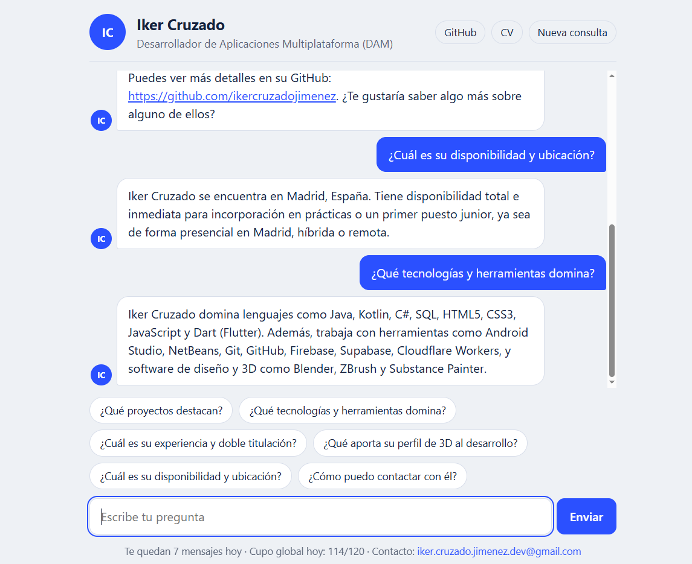
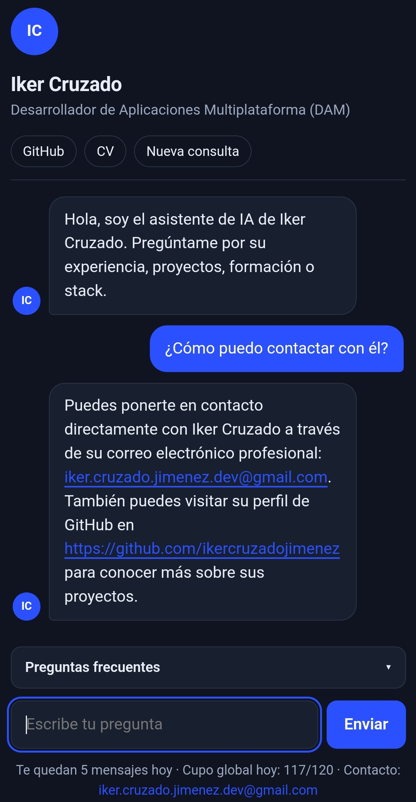

# AI Portfolio Assistant — Iker Cruzado Jiménez


Interactive AI assistant for my professional portfolio as a **Multiplatform Application Developer (DAM)**, built on a **100% zero-cost serverless architecture** so recruiters and technical leads can ask questions about my CV, tech stack, and projects in real time.

**Live Demo:** [https://ikercruzadojimenez.github.io](https://ikercruzadojimenez.github.io)

---

## Key Features

- **Grounded Conversational AI:** Answers strictly from my verified CV and GitHub portfolio data using **Google Gemini 3.5 Flash-Lite**, avoiding hallucinations and responding in the visitor's language.
- **Zero-Cost Serverless Proxy:** Uses **Cloudflare Workers** to keep the Gemini API key completely hidden from the browser.
- **Persistent Rate Limiting (Cloudflare KV):** Tracks real daily usage per IP (`10 requests/day`) and globally (`120 requests/day`) with automatic 24-hour TTL expiration, syncing the remaining quota immediately on page load.
- **Origin & Abuse Protection:** Enforces strict CORS (`ALLOWED_ORIGIN`), input length caps, conversation history trimming, and prompt-injection guardrails.
- **Responsive UI & Direct Actions:** Lightweight vanilla HTML/CSS/JS frontend with automatic light/dark mode support, persistent FAQ chips, and one-click PDF CV download (`cv.pdf`).

---

## Screenshots

| Desktop View — Chat & Markdown Formatting | Mobile View — Collapsible FAQ |
| :---: | :---: |
|  |  |

---

## Architecture

```text
[ Visitor Browser ]
       │  HTTPS (GitHub Pages: index.html + cv.pdf)
       ▼
[ Cloudflare Worker ] ──► Origin Check (CORS) & Input Validation
       │
       ├──► [ Cloudflare KV (LIMITS_KV) ] ──► Per-IP & Global Daily Quotas
       │
       └──► [ Google Gemini API (gemini-3.5-flash-lite) ] ──► System Prompt + Context
```


---

## © Copyright & License

Copyright © 2026 Iker Cruzado Jiménez. All rights reserved.

This repository is publicly available strictly for **portfolio and code-review purposes**. No license is granted to copy, modify, distribute, or use this code for commercial or non-commercial purposes without explicit written permission from the author.
